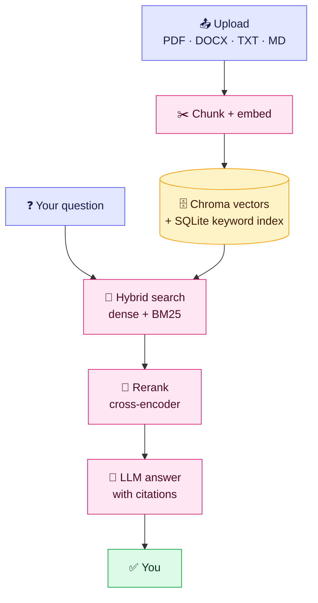
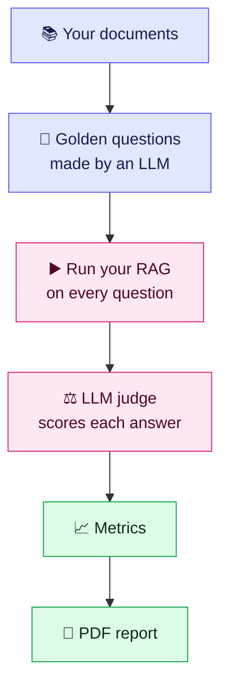

<div align="center">

# 📄 Document RAG Evaluator

### Chat with your documents — then *measure* how good the answers really are.

[](https://document-rag-evaluator.streamlit.app)
[](https://www.python.org/)
[](https://streamlit.io/)
[](#-run-the-tests)

**[👉 Try it live: document-rag-evaluator.streamlit.app](https://document-rag-evaluator.streamlit.app)**

</div>

---

## ✨ What is this?

Upload a **PDF, DOCX, TXT or Markdown** file, ask questions, and get answers **grounded only in your document** with citations.
Then open the **Evaluation Suite** to score the system with LLM-judge metrics and download a PDF report.

Bring your own API key — it lives only in your browser session and is never saved.

## 🎯 Highlights

| | Feature |
|---|---|
| 💬 | **Cited answers** from your own documents, off-topic questions are refused |
| 🔎 | **Hybrid search**: dense vectors + BM25 keyword search + optional cross-encoder reranker |
| 🤖 | **Any provider**: Groq, OpenAI, Gemini, Anthropic, OpenRouter, Ollama (or type any model ID) |
| 📊 | **Evaluation Suite** built on DeepEval: retrieval, answer quality, safety, scope |
| 🧪 | **Golden dataset generator**: creates test questions from your own documents |
| ⚡ | **Free or paid keys**: pacing profiles, *Fast mode*, honest progress bar and cost estimate |
| 👥 | **Many users at once**: each visitor gets an isolated workspace, queue and rate limits |
| 🔒 | **Hardened**: upload limits, XML-bomb protection, no remote images in answers |

## 🧭 How it works



### 📊 The evaluation loop



<details>
<summary><b>📏 Which metrics are measured?</b></summary>

| Group | Metrics |
|---|---|
| 🔍 **Retriever** | Contextual Precision · Recall · Relevancy |
| ✍️ **Generator** | Answer Relevancy · Faithfulness |
| 🎓 **Quality** | Correctness · Completeness |
| 🛡️ **Safety** | Toxicity · PII Leakage · Off-topic scope checks |

</details>

## 🚀 Use it online

1. Open **[the live app](https://document-rag-evaluator.streamlit.app)**
2. In the sidebar pick a **provider** and paste your **API key**
3. Upload a document and press **Ingest Papers**
4. Ask questions 💬
5. Open **Evaluation Suite** (left menu) → generate a golden dataset → run evaluation

> 💡 **Free-tier key?** Choose *Provider plan → Free* and turn on *Fast mode* to avoid rate limits.

## 💻 Run locally

```bash
git clone https://github.com/bahawal-khan/document-rag-evaluator.git
cd document-rag-evaluator

python -m venv venv
venv\Scripts\activate          # Windows
# source venv/bin/activate     # macOS / Linux

pip install -r requirements.txt
streamlit run app.py
```

Optional settings live in [`.env.example`](.env.example) — copy it to `.env`.

## ☁️ Deploy on Streamlit Community Cloud

1. Push this repo to GitHub
2. On [share.streamlit.io](https://share.streamlit.io) choose the repo, branch `main`, file `app.py`
3. **Advanced settings** → Python **3.12 or 3.13**
4. **Secrets** → `EVAL_MAX_WORKERS = "1"` (Cloud has ~2.7 GB RAM)

## ⚙️ Useful settings

| Variable | Default | What it does |
|---|---|---|
| `EVAL_MAX_WORKERS` | 2 | Evaluations running at once |
| `MAX_WORKSPACES` | 300 | Maximum active visitor sessions |
| `MAX_CHAT_PER_MINUTE` | 20 | Questions per visitor per minute |
| `MAX_WORKSPACE_INDEX_MB` | 400 | Largest index one visitor can build |
| `INGEST_MAX_CONCURRENT` | 2 | Visitors indexing at the same time |

## 🧪 Run the tests

```bash
pip install -r requirements-dev.txt
pytest tests -q
```

## 🗂️ Project layout

```text
app.py                  chat page
pages/                  Evaluation Suite page
core/                   retrieval, ingestion, providers, rate limits, jobs
eval/                   DeepEval metrics and PDF report
tests/                  automated tests
```

## ⚠️ Good to know

- Your API key is kept **only in your browser session**.
- Uploaded files are stored per visitor and **deleted after inactivity**.
- Scores from a small question set are a *diagnostic*, not proof — use 20+ questions before trusting them.

## 📜 License

MIT License. See [LICENSE](LICENSE).

<div align="center">

Built by **[Bahawal Khan](https://github.com/bahawal-khan)** · ⭐ Star the repo if it helped!

</div>